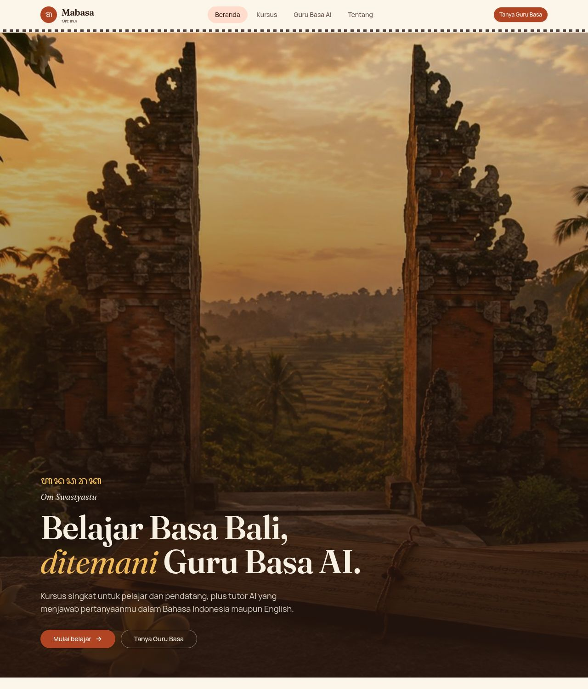
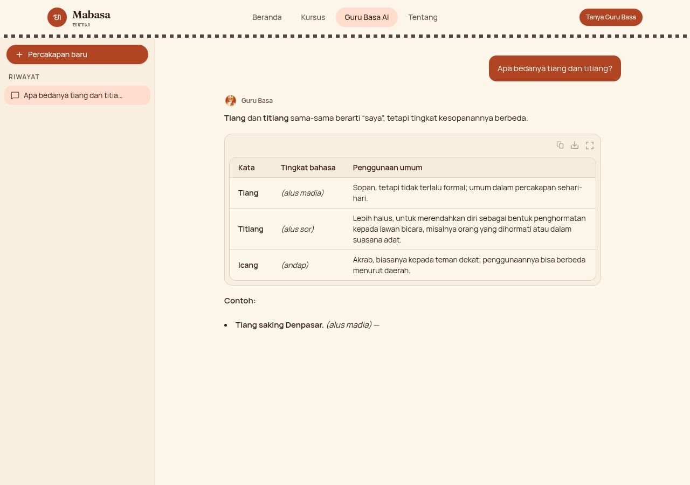

<div align="center">
  

  # ᬫᬩᬲ (Mabasa) — Basa Bali Sahabat Belajar

  **Belajar Basa Bali, ditemani Guru Basa AI.** <br>
  Kursus singkat untuk pelajar dan pendatang, plus tutor AI yang menjawab pertanyaanmu dalam Bahasa Indonesia maupun English.

  _AI Web Innovation Challenge — Bali DigiFest 2026 · "Build with AI, Solve for Bali"_
</div>

---

## 1. Project Name & Description

**Mabasa** adalah platform web pembelajaran Basa Bali berbasis AI. Pengguna mengikuti dua kursus utama — **Pengenalan Basa Bali** dan **Pendidikan Dasar Basa Bali** — lalu berlatih dan bertanya kepada **Guru Basa**, chatbot AI yang khusus membahas Basa Bali dan bisa ditanya dalam Bahasa Indonesia atau Bahasa Inggris.

Area solusi: **Pendidikan** dan **Bali Smart Society (budaya)**.



## 2. Problem

- Penggunaan Basa Bali di kalangan generasi muda menurun; percakapan sehari-hari makin didominasi Bahasa Indonesia.
- Materi belajar digital yang ramah pemula masih terbatas, dan jarang ada tempat bertanya kapan saja.
- Aturan **sor singgih basa** (tingkatan alus/andap) membuat pelajar takut salah sehingga enggan berbicara.
- Pendatang, ekspatriat, dan wisatawan sulit menemukan penjelasan Basa Bali dalam Bahasa Indonesia atau Inggris.

## 3. Target User

- Siswa SD–SMA/SMK di Bali yang mempelajari muatan lokal Basa Bali
- Generasi muda Bali yang ingin lancar kembali berbahasa ibu
- Pendatang, ekspatriat, dan wisatawan
- Guru sebagai alat bantu latihan di luar kelas

## 4. Key Features

| Fitur | Keterangan |
| --- | --- |
| 📚 Kursus **Pengenalan Basa Bali** | Sejarah & pelestarian (Pergub Bali No. 80/2018, Bulan Bahasa Bali), salam sehari-hari, sor singgih basa, 18 aksara wreastra |
| 📘 Kursus **Pendidikan Dasar Basa Bali** | Berhitung, keluarga & urutan nama Bali, kosakata sehari-hari, kata tanya & kalimat sederhana |
| ✅ Kuis per pelajaran | Skor langsung + penjelasan; lulus ≥ 70% menandai pelajaran selesai, kemajuan tersimpan di browser |
| 🤖 **Guru Basa AI** | Chatbot khusus Basa Bali; tanya dalam Bahasa Indonesia atau English, dijawab dalam bahasa yang sama dengan contoh Basa Bali + label tingkat bahasa |
| 🎚️ Fokus tingkat bahasa | Pilih jawaban fokus basa alus, andap, atau keduanya |
| 💬 Banyak percakapan | Riwayat percakapan tersimpan per halaman (`/chat/:id`) di browser, bisa dibuat baru/dihapus |
| ✍️ Latihan terjemahan dikoreksi AI | Pelajar menulis terjemahan bebas; AI menilai BENAR / HAMPIR / SALAH dan menjelaskan perbaikannya |
| 🔗 Tanya dari pelajaran | Tombol "Tanya Guru Basa" di setiap pelajaran membuka chat dengan pertanyaan terkait materi |



## 5. Tech Stack

- **Framework:** React 19 + [TanStack Start](https://tanstack.com/start) (SSR, server routes, server functions), Vite
- **Styling/UI:** Tailwind CSS v4, shadcn/ui, [AI Elements](https://elements.ai-sdk.dev) (komponen chat)
- **AI SDK:** [Vercel AI SDK](https://ai-sdk.dev) (`ai`, `@ai-sdk/react`, `@ai-sdk/google`, `@ai-sdk/openai`)
- **AI model:** Google **Gemini** (`gemini-3.8-flash`) dengan kunci API tim; cadangan otomatis **Lovable AI Gateway** (model OpenAI GPT)
- **Penyimpanan:** `localStorage` browser (riwayat chat & kemajuan belajar) — tanpa login, tanpa database
- **Hosting:** Lovable (edge runtime)
- **Testing:** Vitest

## 6. AI Implementation

AI adalah bagian inti dari dua fungsi utama:

1. **Guru Basa (chatbot)** — `src/lib/ai/guru-basa.server.ts`
   - Instruksi sistem khusus: peran tutor Basa Bali, deteksi bahasa pertanyaan (ID/EN) dan menjawab dalam bahasa yang sama, wajib memberi contoh Basa Bali bercetak tebal dengan label tingkat bahasa (alus singgih / alus sor / alus madia / andap), jujur saat ada variasi dialek, menolak halus topik di luar Basa Bali.
   - Preferensi tingkat bahasa (alus/andap/semua) dari UI disisipkan ke instruksi.
   - Seluruh riwayat percakapan dikirim setiap giliran agar konteks terjaga; jawaban dialirkan (streaming) ke UI.
2. **Koreksi latihan terjemahan** — `src/lib/ai/koreksi.functions.ts`
   - AI membandingkan jawaban pelajar dengan contoh guru, menerima variasi yang tetap benar, lalu memberi vonis (BENAR/HAMPIR/SALAH) + umpan balik singkat.
3. **Ketahanan (fallback)** — `src/lib/ai/gateway.server.ts`
   - Gemini dicoba lebih dulu. Jika gagal sebelum mengeluarkan jawaban (mis. 503 "high demand" atau kuota habis), permintaan otomatis dialihkan ke Lovable AI Gateway sehingga aplikasi tetap bisa diuji juri.

## 7. Architecture / Data Flow

```text
Browser (React)
  ├─ Kursus & kuis ─────────────► materi statis (src/data/courses.ts) + kemajuan di localStorage
  ├─ Guru Basa (useChat) ── POST /api/chat ──► server route (src/routes/api/chat.ts)
  │                                             └─ instruksi Guru Basa + riwayat percakapan
  │                                                ├─► Google Gemini (streaming)
  │                                                └─► cadangan: Lovable AI Gateway
  └─ Latihan terjemahan ── server function koreksiTerjemahan ──► Gemini / cadangan
Riwayat chat ◄── disimpan per percakapan di localStorage (/chat/:threadId)
```

Kunci API hanya dibaca di server (`process.env`), tidak pernah dikirim ke browser.

## 8. Installation / Local Run

Prasyarat: [Bun](https://bun.sh) ≥ 1.1 (atau Node.js ≥ 20 + npm).

```bash
git clone <url-repository-ini>
cd basa-bali-sahabat-belajar
bun install            # atau: npm install
cp .env.example .env   # isi GEMINI_API_KEY
bun run dev            # atau: npm run dev
```

Buka <http://localhost:8080>. Jalankan tes dengan `bun run test`.

## 9. Environment Variables

Lihat [`.env.example`](.env.example). Jangan commit secret asli.

| Variabel | Wajib | Keterangan |
| --- | --- | --- |
| `GEMINI_API_KEY` | Ya (atau `LOVABLE_API_KEY`) | Kunci Google AI Studio untuk Gemini |
| `GEMINI_MODEL` | Tidak | Ganti model Gemini (default `gemini-3.8-flash`) |
| `LOVABLE_API_KEY` | Tidak | Cadangan otomatis; disediakan otomatis saat di-hosting di Lovable |

## 10. Deployment URL

- Live: **_isi setelah publish_** (mis. `https://<nama-proyek>.lovable.app`)
- Tidak memerlukan login — juri bisa langsung mencoba semua fitur.

## 11. Team Members

| Nama | Peran |
| --- | --- |
| _isi nama ketua tim_ | _peran_ |
| _isi nama anggota_ | _peran_ |

## 12. Known Limitations

- Materi kursus disusun dari referensi umum Basa Bali dan sebaiknya ditinjau guru Basa Bali sebelum dipakai resmi di sekolah.
- Jawaban AI bisa keliru, terutama untuk kosakata dialek daerah (Bali Aga) dan Aksara Bali kompleks; aplikasi menampilkan peringatan ini.
- Riwayat chat dan kemajuan hanya tersimpan di browser yang sama (tanpa akun/sinkronisasi antar perangkat).
- Belum ada audio pelafalan dan pengenalan suara.
- Bergantung pada kuota layanan AI; jika Gemini penuh, sistem beralih ke cadangan.

## 13. AI & Technology Disclosure

Lengkap juga di halaman **/tentang** pada aplikasi.

- **AI di dalam produk:** Google Gemini (utama) dan Lovable AI Gateway / OpenAI GPT (cadangan), via Vercel AI SDK.
- **AI-assisted development:** Lovable AI agent dipakai untuk membantu menulis kode, desain antarmuka, dan gambar ilustrasi (hero & maskot dibuat dengan AI image generation). Tim bertanggung jawab atas seluruh kode dan perilaku aplikasi.
- **Data:** tidak ada data pribadi yang disimpan di server.

## 14. Third-party Resources / Credits

- [TanStack Start](https://tanstack.com/start), [React](https://react.dev), [Tailwind CSS](https://tailwindcss.com), [shadcn/ui](https://ui.shadcn.com), [AI Elements](https://elements.ai-sdk.dev), [Vercel AI SDK](https://ai-sdk.dev), [Lucide icons](https://lucide.dev) — lisensi MIT/ISC
- Font: [Fraunces](https://fonts.google.com/specimen/Fraunces), [Manrope](https://fonts.google.com/specimen/Manrope), [Noto Sans Balinese](https://fonts.google.com/noto/specimen/Noto+Sans+Balinese) — SIL Open Font License
- Gambar hero dan maskot Guru Basa: dibuat dengan AI image generation untuk proyek ini
- Rujukan materi: Pergub Bali No. 80 Tahun 2018 tentang Pelindungan dan Penggunaan Bahasa, Aksara, dan Sastra Bali

---
<div align="center">
  Dibuat dengan ❤️ untuk pelestarian Bahasa dan Budaya Bali. <br>
  <em>Om Santih, Santih, Santih, Om</em>
</div>
